<div align="center">
  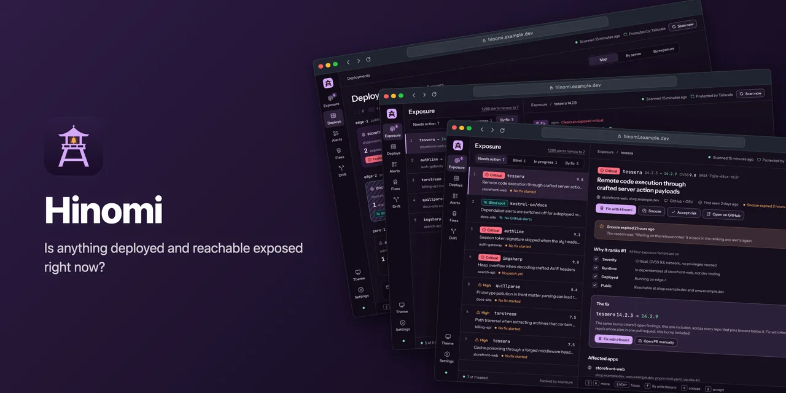

  

  <h1>Hinomi</h1>

  <p><strong>A small self-hosted app that tells you whether anything deployed and reachable is exposed to a serious vulnerability.</strong></p>

  <p>
    <a href="https://github.com/Shironex/hinomi/actions/workflows/ci.yml">
      
    </a>
    <a href="https://github.com/Shironex/hinomi/releases/latest">
      
    </a>
    <a href="https://github.com/Shironex/hinomi/pkgs/container/hinomi">
      
    </a>
    <a href="LICENSE">
      
    </a>
  </p>

  <p>
    <a href="docs/self-hosting.md"><strong>Self-hosting</strong></a>
    &nbsp;·&nbsp;
    <a href="docs/spec.md"><strong>Spec</strong></a>
    &nbsp;·&nbsp;
    <a href="https://github.com/Shironex/hinomi/milestones"><strong>Roadmap</strong></a>
    &nbsp;·&nbsp;
    <a href="CONTRIBUTING.md"><strong>Contributing</strong></a>
  </p>
</div>

The name comes from the fire lookout towers of old Japanese towns. The watchman did not watch every house; he looked for real smoke and rang the bell.

---

## What Hinomi answers

GitHub can report thousands of Dependabot alerts across a few dozen repos, and most of them sit in repos that are not deployed anywhere. Meanwhile alerts can be switched off on a repo without anyone noticing, so a critical advisory on a live site produces no alert at all.

Hinomi answers one question: **is anything that is actually deployed and reachable right now exposed to a serious vulnerability?** It joins your deployments with your advisories, ranks every finding by real exposure, and reports the repos it cannot see into as findings of their own.

I built it for my own servers: a dozen apps on Coolify, one person looking after them. It reads; it does not change your repos or deployments.

## Screenshots

<table>
  <tr>
    <td width="50%">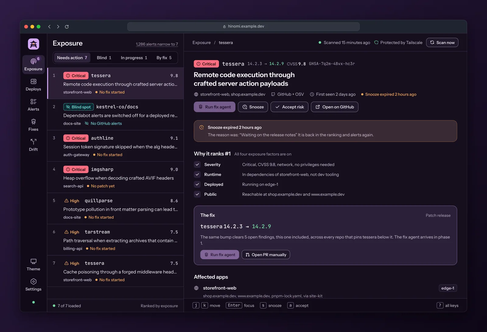</td>
    <td width="50%">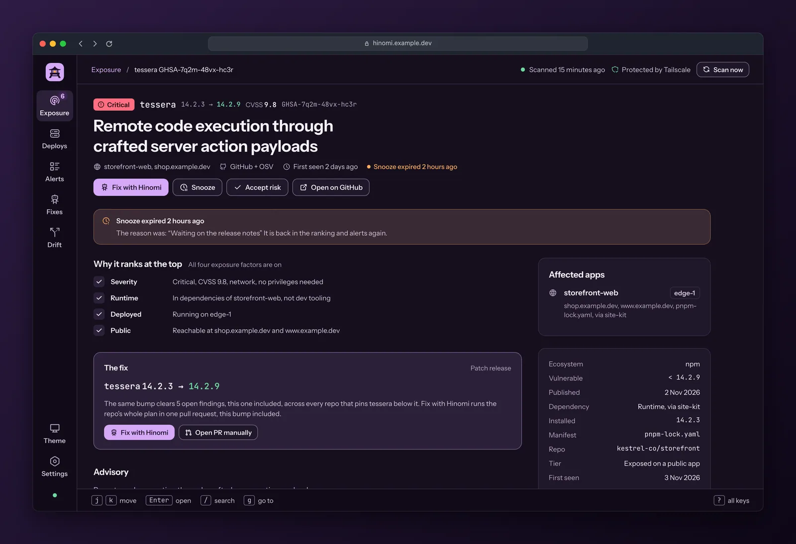</td>
  </tr>
  <tr>
    <td align="center"><sub>Exposure: 1,286 alerts narrow to the few on public apps, ranked, with the top finding open.</sub></td>
    <td align="center"><sub>Finding: why it ranks where it does, the fix and the affected apps.</sub></td>
  </tr>
  <tr>
    <td width="50%">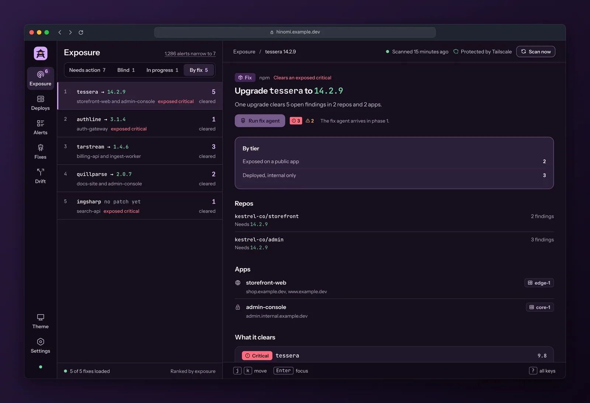</td>
    <td width="50%">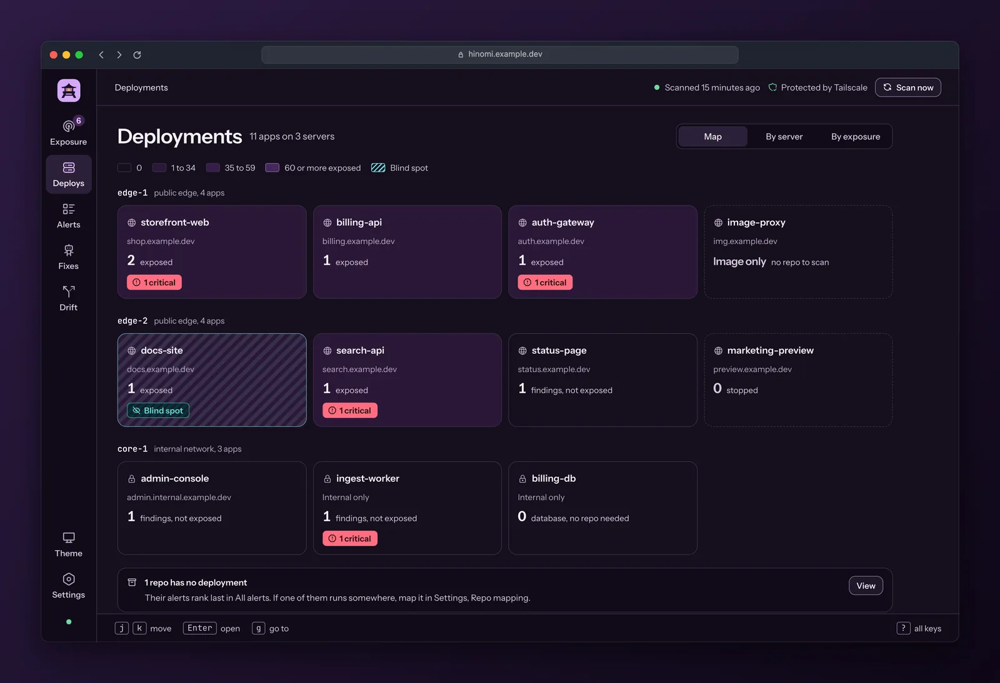</td>
  </tr>
  <tr>
    <td align="center"><sub>By fix: the package bumps that clear the most findings, across repos and apps.</sub></td>
    <td align="center"><sub>Deployments: every app by server, shaded by exposure, with blind spots marked.</sub></td>
  </tr>
  <tr>
    <td width="50%">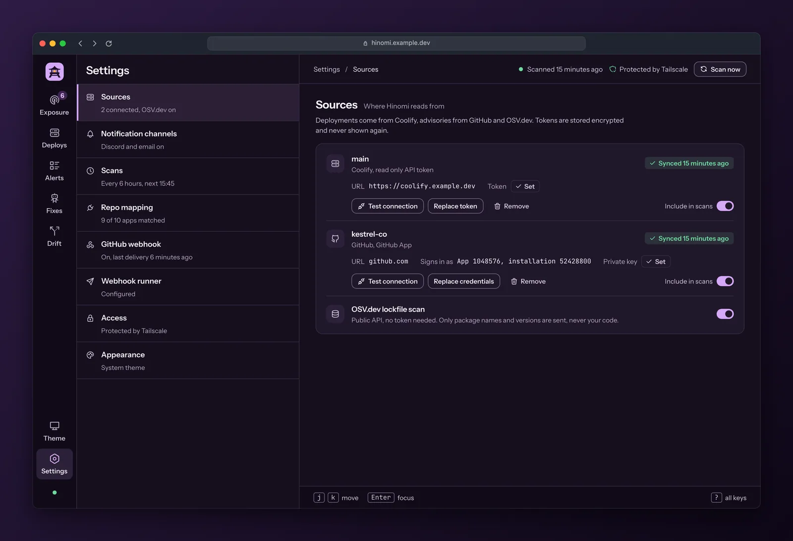</td>
    <td width="50%">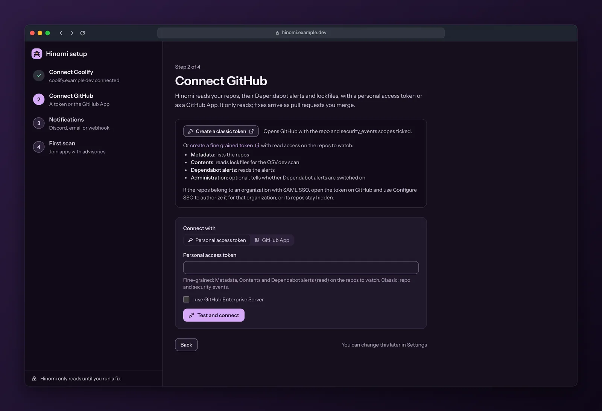</td>
  </tr>
  <tr>
    <td align="center"><sub>Settings: Coolify, GitHub and OSV.dev sources, channels, scans and repo mapping.</sub></td>
    <td align="center"><sub>Setup: four steps from an empty instance to the first scan.</sub></td>
  </tr>
</table>

<p align="center">
  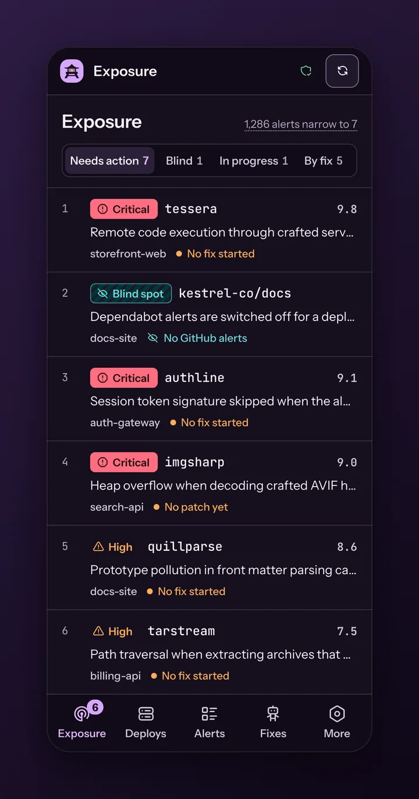
  <br /><sub>On a phone: the same ranking with bottom tabs. It installs as an app, see <a href="docs/self-hosting.md#install-as-an-app">Install as an app</a>.</sub>
</p>

<details>
<summary>The same views in the light theme</summary>

<table>
  <tr>
    <td width="50%">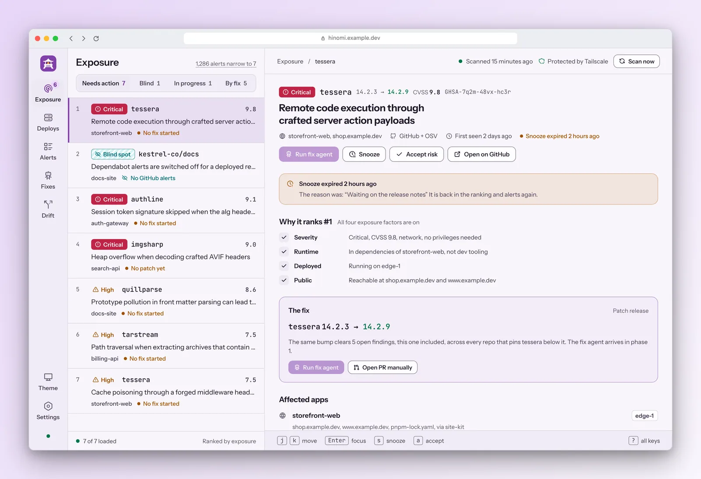</td>
    <td width="50%">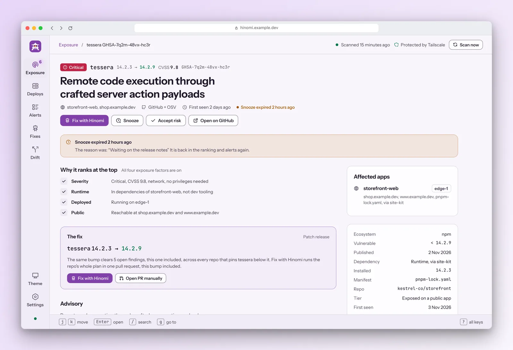</td>
  </tr>
  <tr>
    <td width="50%">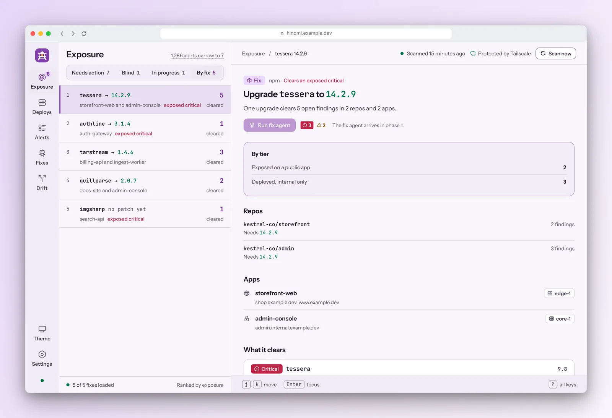</td>
    <td width="50%">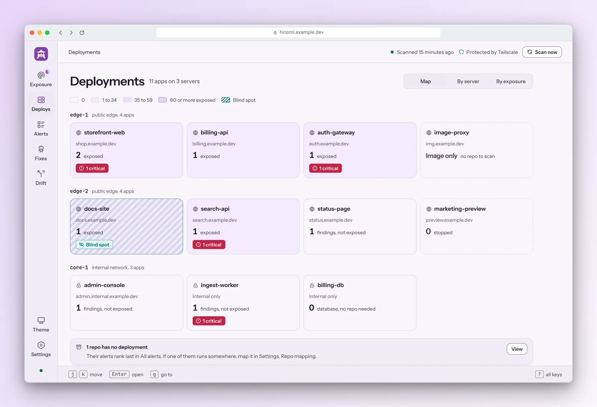</td>
  </tr>
  <tr>
    <td width="50%">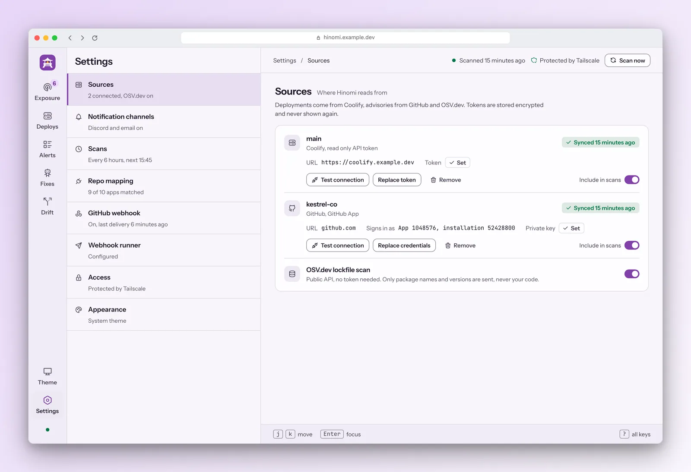</td>
    <td width="50%">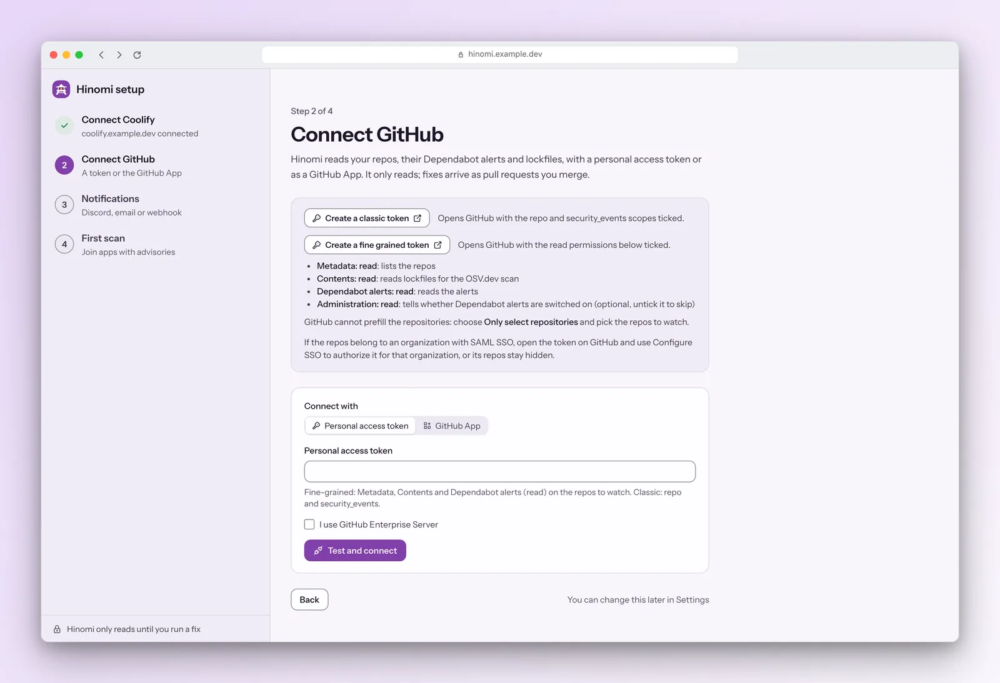</td>
  </tr>
</table>

</details>

Every name, host and advisory in these images is invented. They are captured from a fixture mode of the web app, see [Screenshots](CONTRIBUTING.md#screenshots).

## How it works

### Sources

| Source | What Hinomi reads |
|---|---|
| **Coolify** | Applications, services and databases: git repo and branch, domains, server, status, image and last deploy. A read only API token is enough. |
| **GitHub** | Repos, whether Dependabot alerts are switched on, and the Dependabot alerts themselves (severity, CVSS, runtime or development scope, vulnerable range, first patched version). Connect with a personal access token or a GitHub App, see [docs/github.md](docs/github.md). |
| **OSV.dev** | An independent check of the lockfiles in each repo, which also covers repos where Dependabot is off. Only package names and versions are sent. It can be switched off in Settings. |

A scan runs on a schedule (every 6 hours by default, from 15 minutes to 7 days) and whenever you press Scan now. Repos are mapped to deployments from the Coolify git repository field, with manual overrides in Settings for monorepos and renamed repos.

### Ranking

Every finding is ranked by four factors: severity, runtime or development code, deployed or not, and public or internal. Nothing is hidden; the list is sorted into tiers:

1. **Blind spots**: something deployed that Hinomi cannot see into.
2. **Exposed**: a critical or high advisory in runtime code of an app with a public domain.
3. **Internal**: deployed, but only on an internal network.
4. **Public, moderate or low**.
5. **Development only**: deployed repos, dev dependencies.
6. **Not deployed**.
7. **Patched in the lockfile**: GitHub still reports it, but every locked version is already patched.
8. **Coverage notes**: deployments with no git source, such as an app run from a registry image.

The Exposure view lists the first two tiers, and its By fix tab groups them by the package bump that clears the most findings. Everything else lives in All alerts, with filters. A finding can be snoozed or accepted with a reason, until a date or until a new advisory appears for the same package; both stay visible in the In progress tab and come back when they end.

### Blind spots

A deployed repo with no advisory coverage is reported as a finding instead of staying silent: Dependabot alerts switched off, alerts the token cannot read, an archived repo that is still deployed, a deployment with no repo mapped, and a lockfile that is missing or cannot be parsed.

### Notifications

New or reopened critical and high findings on deployed repos, and new blind spots, go out right after a scan, with a daily digest for the rest. Channels: Discord, a generic webhook, and email over SMTP. See [docs/notifications.md](docs/notifications.md).

## Quick start

Hinomi is one container with a SQLite database in `/data`. Images for `linux/amd64` and `linux/arm64` are published to `ghcr.io/shironex/hinomi` on every release, tagged `X.Y.Z`, `X.Y` and `latest`. Until the first release is tagged there is nothing to pull; [build from source](#build-from-source) meanwhile.

It has no login yet, so read [Access](#access) before you connect a token. The full guide, with Coolify, tokens, upgrades and backups, is [docs/self-hosting.md](docs/self-hosting.md).

### Docker compose

```sh
curl -O https://raw.githubusercontent.com/Shironex/hinomi/main/docker-compose.yml
docker compose up -d
curl localhost:3000/api/health
```

Then open `http://localhost:3000`; setup starts there. Pin a release with `HINOMI_VERSION=0.1.0 docker compose up -d`. Without it Compose follows `latest`; run `docker compose pull` to update.

The container runs as uid 10001 and keeps its database in the `hinomi-data` volume. Migrations run on boot. Each image carries an SBOM and build provenance:

```sh
gh attestation verify oci://ghcr.io/shironex/hinomi:latest -R Shironex/hinomi
```

### Coolify

Create an application from the Docker image `ghcr.io/shironex/hinomi:<version>` (or the public repository with the Dockerfile build pack) on port `3000`, add a volume at `/data`, set `HINOMI_SECRET_KEY`, and publish the port on your tailnet only. The step by step setup, including the health check and stop grace period, is in [docs/self-hosting.md](docs/self-hosting.md#coolify).

### Build from source

Clone the repository, switch `docker-compose.yml` to the `build: .` lines (see the comments in the file), then:

```sh
docker compose up -d --build
```

## Access

Hinomi has no login yet, so it must sit behind something that has one: [Tailscale](docs/self-hosting.md#tailscale) or [Cloudflare Access](docs/self-hosting.md#cloudflare-access). On every page it shows how the current request reached it: "Protected by Tailscale" or "Protected by Cloudflare Access" in the top bar, and a red bar on every page when a request comes from a public address. How that is decided, and which proxies it trusts, is in [docs/access.md](docs/access.md).

## Configuration

No environment variables are required; see [.env.example](.env.example).

| Variable | Default | What it does |
|---|---|---|
| `HOST` | `0.0.0.0` | Address the server listens on. |
| `PORT` | `3000` | Port the server listens on. |
| `HINOMI_DATA_DIR` | `/data` in the container, `./data` in dev | Folder that holds `hinomi.db`. |
| `HINOMI_SECRET_KEY` | unset | Key material for encrypting source tokens at rest (AES-256-GCM). At least 16 characters, for example `openssl rand -base64 32`. Without it Hinomi runs, but sources cannot be connected. Keep it stable: a new key makes stored tokens unreadable. |
| `HINOMI_TRUSTED_PROXIES` | unset | Comma separated IPs or CIDR ranges of reverse proxies whose `X-Forwarded-For`, `CF-Connecting-IP` and Tailscale identity headers are believed. Unset, they are all ignored. See [docs/access.md](docs/access.md). |
| `HINOMI_CF_ACCESS_TEAM_DOMAIN` | unset | Cloudflare Access team name or `https://<team>.cloudflareaccess.com`. With `HINOMI_CF_ACCESS_AUD`, Hinomi verifies the Access token and shows "Protected by Cloudflare Access". |
| `HINOMI_CF_ACCESS_AUD` | unset | Application Audience (AUD) tag of the Access application. Set both Cloudflare variables or neither. |
| `HINOMI_WEBHOOK_PORT` | unset | A second port that serves only the optional GitHub webhook path, so a tunnel pointed at it reaches nothing else. Must differ from `PORT`. See [docs/github-webhook.md](docs/github-webhook.md). |
| `HINOMI_SHUTDOWN_TIMEOUT_SECONDS` | `25` | How long a stop (SIGTERM or SIGINT) waits for a running scan before it is marked interrupted. Whole seconds from 0 to 3600. Keep it below the stop grace of your platform, or the container is killed first. |

Tokens and GitHub App private keys are never logged and never sent to the browser; the API only says whether one is set. GitHub connects with a personal access token or a GitHub App, see [docs/github.md](docs/github.md).

### Stopping while a scan runs

On a stop the server waits for the running scan (up to `HINOMI_SHUTDOWN_TIMEOUT_SECONDS`) so it can finish and be saved. Docker kills the container after its stop grace period, 10 s by default, so the bundled `docker-compose.yml` sets `stop_grace_period: 30s`. If you raise the variable, raise the grace period above it. On Coolify, set the same in the application under Advanced, "Stop Grace Period (seconds)" (empty means 30 s, accepted values 1 to 3600).

## Roadmap

Hinomi is in its first release. What comes next is planned in milestones:

- [v0.1.0](https://github.com/Shironex/hinomi/milestone/1): the redesign, repo setup, GHCR images and the installable web app. The first release.
- [v0.2.0](https://github.com/Shironex/hinomi/milestone/2): phase 1, fix runs. A "Run fix agent" button per finding opens a dependency bump pull request through a GitHub Actions runner, then tracks it until a rescan verifies the fix. The button is already in the UI, but disabled until then.
- [v0.3.0](https://github.com/Shironex/hinomi/milestone/3): phase 2, drift guards (containers running as root, shared networks, outdated frameworks, watch paths), an image scan for deployments with no repo, a desktop tier for shipped apps, and built in auth.
- [Later](https://github.com/Shironex/hinomi/milestone/4): ideas worth doing after phase 2.

The reasoning behind all of it is in [docs/spec.md](docs/spec.md).

## Development

Requires Node 26 and pnpm. Node 26 no longer bundles corepack, so run `npm install --global corepack` once, then `corepack enable`.

```sh
pnpm install
pnpm dev        # server on :3000, web on :5173 (proxies /api to the server)
pnpm lint
pnpm typecheck
pnpm test
pnpm build
```

`pnpm --filter @hinomi/web dev:fixtures` runs the web app alone on invented data, no server needed. The HTTP API is described in [docs/api.md](docs/api.md).

## Contributing

Issues and discussions come first: please open an [issue](https://github.com/Shironex/hinomi/issues/new/choose) or start a [discussion](https://github.com/Shironex/hinomi/discussions) before a pull request, so we agree on the change before you build it. The setup, the gate and the commit rules are in [CONTRIBUTING.md](CONTRIBUTING.md). Security reports go through [SECURITY.md](SECURITY.md), not issues.

## License

[AGPL-3.0](LICENSE).
